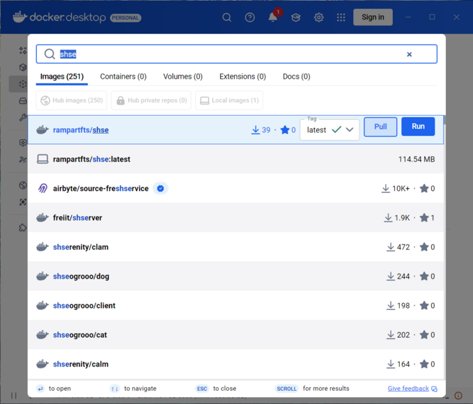
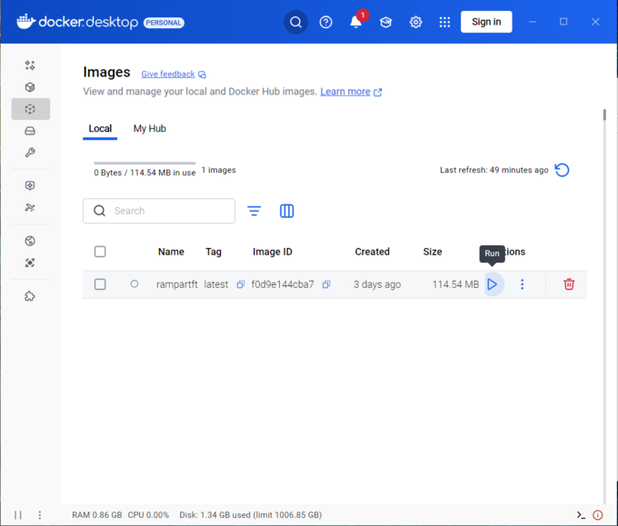
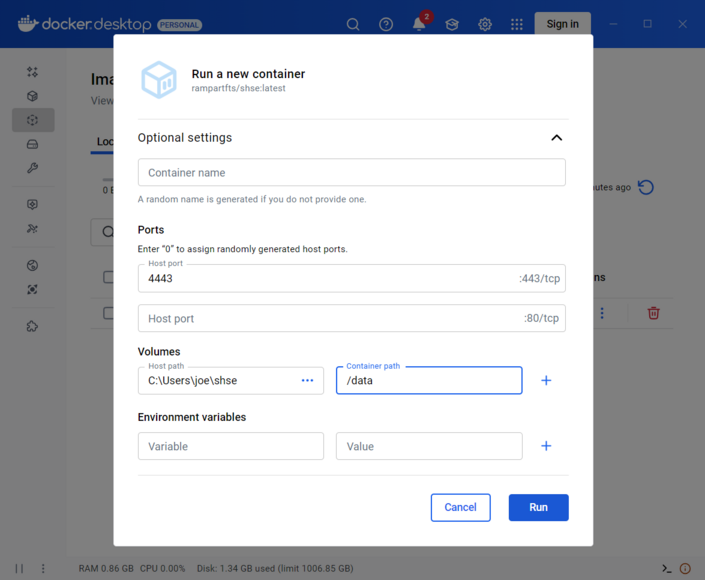
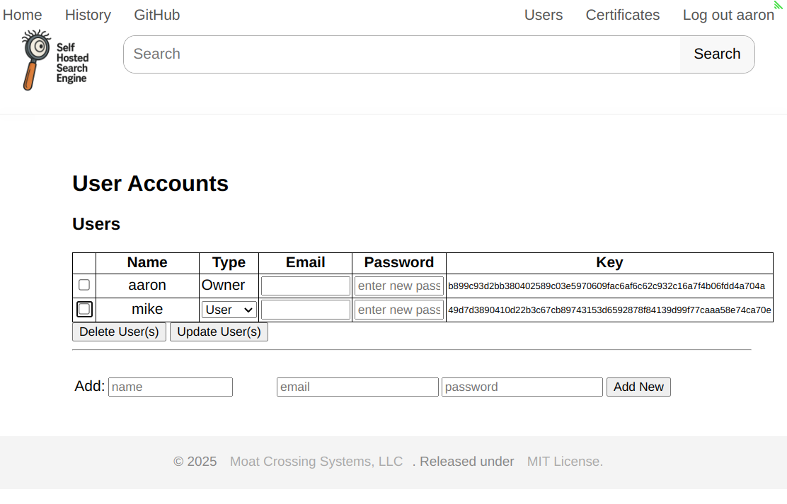
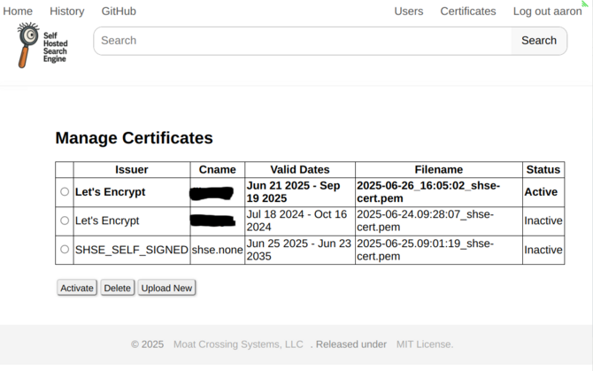
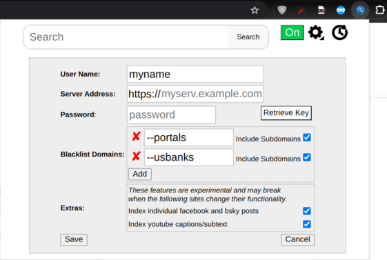
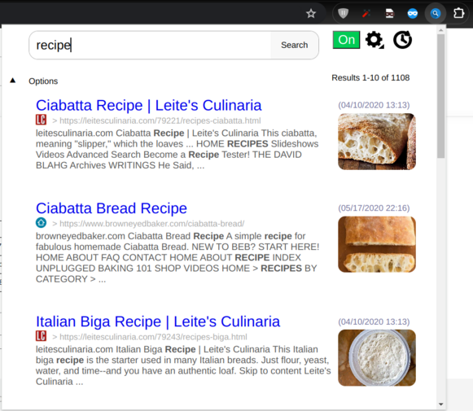
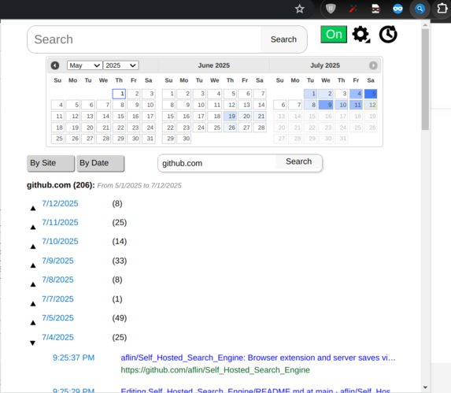
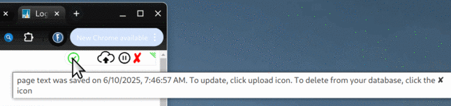

# Self_Hosted_Search_Engine
A browser extension and a server that save the pages you visit to a personal, full text search engine that you run yourself.

* The **extension** sends the text of each page you visit to your server.
* The **server** indexes it, and lets you search it and look through your browsing history, from the extension's popup or from its own web pages.
* The server is also an **MCP server**, so an LLM can search what you have read ([see below](#mcp-server-for-llms)).

# Extension

The Chrome extension is available [here](https://chromewebstore.google.com/detail/self-hosted-search-engine/djekcahnfnhijkpnhfcmcgldbkoiagjd).

The Firefox extension is available [here](https://addons.mozilla.org/en-US/firefox/addon/self-hosted-search-engine/).

We have not yet published to the Safari store.

# Server

## Direct Use:
The server requires [rampart](https://rampart.dev/) version 0.7.5 or later, and ``openssl``.  Clone this repo and start the server with
```
sudo ./shse-server.sh
```
It must be started as root: it listens on ports 443 and 80, then drops to the user ``nobody``, and it changes the ownership of the ``web_server`` directory to that user.  The first time it runs it creates a self signed certificate.  Your database is kept in ``web_server/data``.

More configuration can be found in the [web_server/web_server_conf.js](web_server/web_server_conf.js) file.

If you plan to run it behind, e.g., nginx reverse proxy (with its own valid certificates), you can start the server in httpOnly mode
```
sudo ./shse-server.sh httpOnly
```
In this mode, it will be available on port **8070** (or the ``httpOnlyPort`` specified in [the web_server_conf.js](web_server/web_server_conf.js) file).

The server is stopped with ``sudo rampart web_server/web_server_conf.js stop``.

## Docker Command Line:

You will likely want your data to persist in order to later pull the latest shse image without losing your data, so here is a suggested use:
```
mkdir ~/.shse-data
docker run -d -p 4443:443 -v ~/.shse-data:/data rampartfts/shse
```
The server must run as a secure server in order to view the webpage and for the browser plugin to work.  When the server starts the first time, it will create its own self signed certificate.
This will require you to go to, e.g., ``https://localhost:4443/`` and "accept the risks".

There is a certificate management page should you wish to upload valid certificates (see below).

If you plan to run it behind, e.g., nginx reverse proxy (with its own valid certificates), you can start the server in httpOnly mode:
```
docker run -d -p 8080:80 -v ~/.shse-data:/data rampartfts/shse httpOnly
```
In this mode, it will be available on port **8080** (or whichever port you give in the ``-p`` option above).

The image is built for both amd64 and arm64.

## Docker Desktop:

First find the shse image and pull:



Find it in the images tab and click run:



Add options for ports and to mount the ``/data`` directory, then run it.



## Docker Caveats
__Do not__ run more than one docker using the same ``/data`` volume host path, or corruption will likely occur (database locking happens inside each container and is not shared between containers).

# Setup

## Server
After starting the server and navigating to, e.g. ``https://localhost:4443/``, you will be asked to enter a user name and a password.  This
will be the "Owner's" account, which has and can confer admin privileges to other users.

From there, as the Owner (or as an admin) you will be able to add users and upload certificates.

__Users Page:__



* note email is saved, but not used at this time.

__Certificates Page:__



## Plugin
After installing the plugin for the browser (*and pinning it to the toolbar*), click on the popup magnifying glass in the browser toolbar and in the popup, click on
the gear icon.



Enter the relevant information, click retrieve key and save.
There will be two groups of urls that are by default blacklisted:  Banks (such as citibank, wellsfargo, chase, etc), and Portals (such as google, yahoo, bing, chatgpt, etc).  When you add the server address, it will be added to the blacklist as well.  Any or all of these can be removed, and more added to suit your needs.

You can find the list of ``--banks`` and ``--portals`` at the top of the source code in the [extension/js/shseContentScript.js file](https://github.com/aflin/Self_Hosted_Search_Engine/blob/main/extension/js/shseContentScript.js)

Note also the option to index individual facebook and bsky posts, and the option to grab youtube captions.  These are unchecked by default.

* With the first option, each post you scroll past on facebook, or on the bsky.app home page, is saved as its own entry with a link to that post.  Be aware that this can result in a disproportionately large number of those entries in the index, but it should not otherwise affect the quality of search results.
* With the second, the transcript of a youtube video you watch is saved with the page, under a ``Transcript:`` heading with a timestamp every 30 seconds.

Both of these depend on how those sites build their pages, which changes from time to time.

Once you start browsing, pages will automatically be saved to the server's database.  When you wish to find a page you've already visited, you can use either the server's page or the popup to search.  Clicking on "Options" above the results will allow you to delete individual pages, a selection of them, or everything from a site.



By clicking on the history icon (or visiting the History page on the server), you can also examine your browsing history on any given day, ordered by date or grouped by site.  You can also search for a domain and get a listing of dates when you visited that domain in the current 3 month time span displayed (as shown below).



## In Tabs

When the extension is active (button next to the gear button says "ON" and is green), every page in every tab will have a small "infobox" control bar at the top-right.
It can be collapsed to minimize its presence on the page.



If you do not wish to index every page, you can click the pause button in the control bar to enter *manual mode*.  When in *manual mode*, pages are not automatically saved to the server, but can be individually indexed by clicking the upload button in the control bar.

# MCP Server (for LLMs)

The server is also an [MCP](https://modelcontextprotocol.io) server, so a local or hosted LLM can search the pages you have saved and look through your history.  It pairs well with [alpacaLIPS](https://github.com/aflin/alpacaLIPS): that answers "what do public sources say", this answers "what have I already read".

To connect an MCP client you need two things:

* The URL: ``https://your.server/apps/shse/mcp.json``
* A custom header named ``Authorization`` with the value ``Bearer YOUR_KEY``, where the key is the same one the browser plugin uses (the one "retrieve key" fills in on its settings page).  An admin can also see it on the Users page, or with ``rampart web_server/apps/shse.js listUsers``.

The transport is Streamable HTTP (stateless, POST only), so the client must be one that can talk to a remote server and send a custom header.  For example, with Claude Code:
```
claude mcp add --transport http shse https://your.server/apps/shse/mcp.json --header "Authorization: Bearer YOUR_KEY"
```

The tools are read only.  Nothing can be stored or deleted through them:

* ``shse_search`` - ranked keyword search over saved pages, optionally limited by site and date.
* ``shse_fetch`` - the stored text of one page, read in windows.
* ``shse_locate`` - find an exact string inside one page.
* ``shse_history`` - visits by date range and/or site, newest first, including pages whose text was not saved.

Every result carries a ready made markdown link to the page, and the model is told to include it, so answers come with links you can click.

Things to be aware of:

* The key is derived from your password, so changing the password changes the key for both the plugin and any MCP client.
* The key lets a client do everything the plugin can, including storing and deleting pages through the plugin's own endpoints.  Only the MCP tools are read only.
* The text of saved pages was written by whoever published them and is handed to the model as is.  The model is told to treat it as data and not as instructions, but that is a request, not a guarantee.
* Whatever the model reads from your archive goes wherever that model runs.  With a hosted LLM, that means your browsing leaves your machine.

# Command Line

The main server script can also be run by hand, as a user that can write to the database (e.g. ``sudo -u nobody``):
```
rampart web_server/apps/shse.js listUsers
rampart web_server/apps/shse.js updateUser <existingUsername> <newPassword>
rampart web_server/apps/shse.js makeUserdb <username>
```
``listUsers`` shows each account with its type and key.  ``updateUser`` sets a new password (and so a new key) when one has been forgotten.

# Development

* ``extension/`` is the plugin for Chrome (Manifest V3) and ``extensionv2/`` the same plugin for Firefox (Manifest V2).  Apart from ``manifest.json`` the two are kept identical.
* ``./make-extension-packages.sh`` builds the two zip files that are uploaded to the Chrome Web Store and addons.mozilla.org, named for the version in the manifests.
* ``web_server/apps/shse.js`` is the server.  It needs ``web_server/lib/shse-mcp.js`` for the MCP endpoint, and ``web_server/html/`` for the web pages.  If you link it into another rampart web server rather than using the one here, bring all three.
* ``docker/update-vendored.sh`` refreshes the files the docker images are built from: a trimmed rampart from the official release, and a copy of ``web_server/``.  ``docker/build-multiarch-glibc.sh`` then builds and pushes the amd64 and arm64 images.

# License Caveats

Note that although this project is permissively licensed, as is [rampart](https://rampart.dev/), the sql search engine is under a [different license](https://github.com/aflin/rampart/blob/main/LICENSE-tsal.txt).  For most DIYers, this should not restrict your use in any way.  If you want to sell this as a service or product, you must contact us.

Enjoy!
